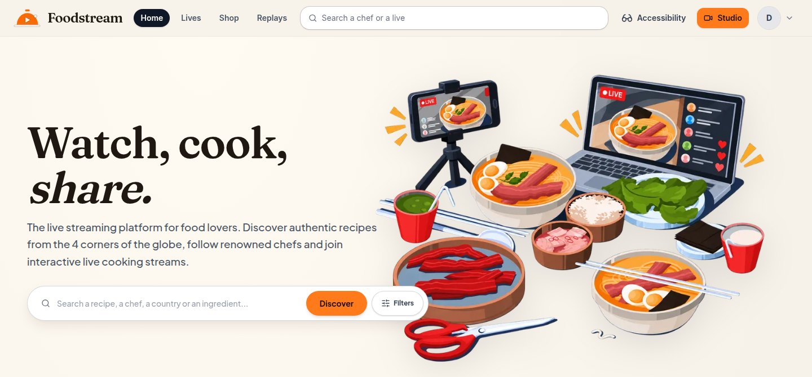
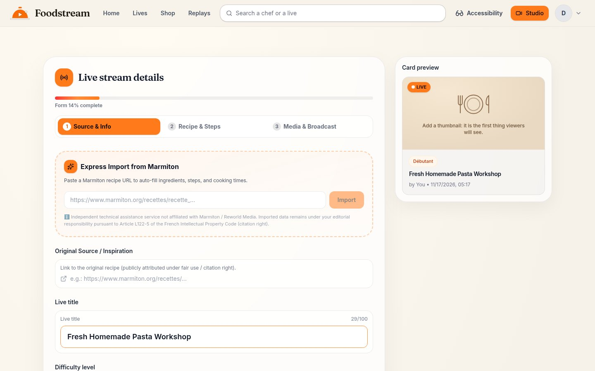

# Foodstream

**Cook together, live.**

[Website](https://www.foodstream.tv) · [Discord](https://discord.gg/msWJhKv5UD)

Foodstream is a live streaming platform for food recipes. Cooks go live from their browser or their phone, viewers watch and chat while the dish comes together, and every live stays available as a replay.

  

## How it works

1. **Prepare** a live in the Studio: title, recipe, ingredients and steps, a thumbnail. A recipe can be imported from a link.
2. **Go live**, now or at a scheduled time, and invite co-streamers to cook the same recipe together.
3. **Watch and chat** in real time, then **replay** any past live.

  

## Repositories

| Repository | What it is |
| :--- | :--- |
| [etchebest](https://github.com/Foodstream-tv/etchebest) | The Foodstream platform: web app, API and mobile app |
| [pre-launch](https://github.com/Foodstream-tv/pre-launch) | The pre-launch page |
